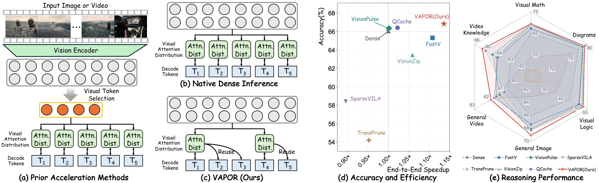
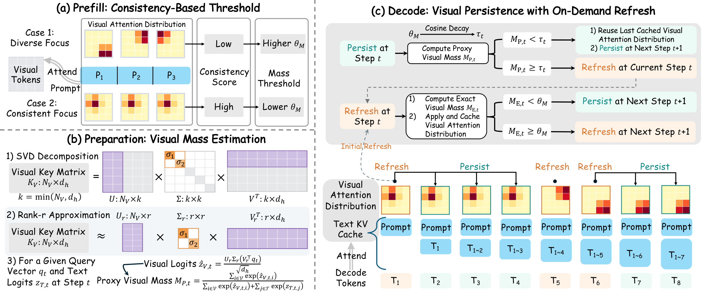
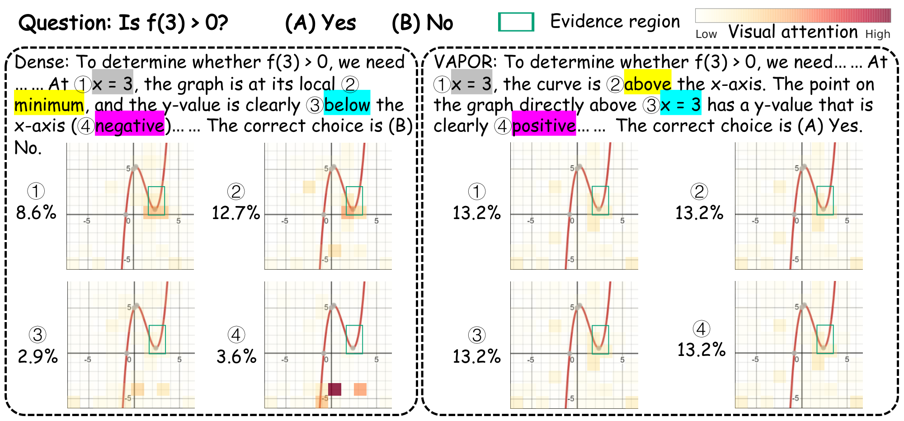

# VAPOR

### Improving Multimodal Reasoning with Sparse Visual Updates

[Results](#results) · [Method](#method) · [Visual grounding](#visual-grounding) · [Quick start](#quick-start)

**VAPOR (Visual Attention Persistence with On-demand Refresh)** is a **training-free framework for faster and more accurate multimodal reasoning**. It reuses visual attention outputs across decoding steps and refreshes them when new visual evidence is needed, while textual attention continues to update. Lightweight visual-mass estimation guides independent decisions for each attention head, preserving access to the full visual context without permanently pruning visual tokens.

**12 reasoning benchmarks · 2 MLLM families · 1.11–1.21× decoding speedup · Accuracy gains over Dense: Qwen3-VL +0.81–0.85 pp / InternVL3.5 +0.43–0.49 pp**



*VAPOR improves accuracy and end-to-end inference speed on Qwen3-VL-8B across eight image and four video reasoning benchmarks.*

- **Reuse visual evidence, update text.** Maintain a stable visual attention output while the model continues reasoning.
- **Refresh when needed.** Low-rank visual-mass estimation, prefill consistency, and cache age determine when each head should seek new evidence.
- **Keep all visual tokens available.** The full visual KV cache remains accessible for every refresh.

## Results

VAPOR achieves the **highest average accuracy among the compared methods in all four model–modality settings**, exceeding the strongest evaluated acceleration baseline by **0.35–2.15 percentage points**.

| Model | Reasoning | Dense acc. (%) | VAPOR acc. (%) | Gain (pp) | Decode speedup |
|---|---|---:|---:|---:|---:|
| Qwen3-VL-8B | Image | 67.63 | **68.48** | **+0.85** | **1.15×** |
| Qwen3-VL-8B | Video | 62.77 | **63.58** | **+0.81** | **1.14×** |
| InternVL3.5-8B | Image | 63.59 | **64.08** | **+0.49** | **1.21×** |
| InternVL3.5-8B | Video | 63.17 | **63.60** | **+0.43** | **1.11×** |

Accuracy is the unweighted mean across the eight image or four video benchmarks. Decoding speedup is relative to Dense, computed from the mean decoding latencies in Table 1. The teaser above instead reports **end-to-end** speedup.

<details>
<summary><strong>Compare all methods: accuracy and decoding latency</strong></summary>

**Qwen3-VL-8B**

| Method | Image acc. (%) ↑ | Image decode (s) ↓ | Video acc. (%) ↑ | Video decode (s) ↓ |
|---|---:|---:|---:|---:|
| Dense | 67.63 | 87.1 | 62.77 | 37.1 |
| FastV | 66.59 | 79.5 | 62.78 | 33.8 |
| VisionPulse | 68.12 | 87.4 | 62.82 | 36.3 |
| SparseVILA | 56.69 | 99.7 | 61.84 | 34.5 |
| TransPrune | 51.06 | 94.8 | 60.49 | 34.5 |
| VisionZip | 64.32 | 84.4 | 61.75 | 32.9 |
| QCache | 68.13 | 86.1 | 62.96 | 35.0 |
| **VAPOR** | **68.48** | **75.7** | **63.58** | **32.6** |

**InternVL3.5-8B**

| Method | Image acc. (%) ↑ | Image decode (s) ↓ | Video acc. (%) ↑ | Video decode (s) ↓ |
|---|---:|---:|---:|---:|
| Dense | 63.59 | 26.8 | 63.17 | 7.2 |
| FastV | 60.21 | 22.6 | 61.25 | **5.2** |
| VisionPulse | 61.93 | 25.3 | 63.06 | 6.5 |
| SparseVILA | 54.17 | 24.5 | 61.25 | 5.7 |
| TransPrune | 57.45 | 23.2 | 61.93 | 6.2 |
| VisionZip | 54.69 | 25.8 | 61.92 | 5.6 |
| QCache | 58.36 | 31.6 | 59.94 | 11.9 |
| **VAPOR** | **64.08** | **22.2** | **63.60** | 6.5 |

Latency is measured in seconds per sample. Both accuracy and latency are averaged equally across benchmarks within each modality; bold marks the best value in each column.

</details>

**Image reasoning:** MathVista, MathVerse, DynaMath, WeMath, AI2D, LogicVista, MMBench, and MMMU-Pro.  
**Video reasoning:** MVBench, Video-MME, MMVU, and Video-MMMU.

## Method



1. **Calibrate during prefill.** Attention consistency across prompt tokens sets the base refresh threshold.
2. **Estimate visual demand.** Low-rank visual key factors provide inexpensive visual-mass estimates during decoding.
3. **Persist or refresh, head by head.** Reuse the cached conditional visual attention output when demand is low. Refresh immediately when the proxy crosses the age-adjusted threshold, or when the cache reaches its age limit.

Textual attention updates at every step, and all visual tokens remain available throughout generation.

## Visual grounding



In this graph-reading example, VAPOR maintains **13.2%** of visual attention on the evidence region across four sampled reasoning positions and answers correctly. Dense attention shifts away from that region and reaches an incorrect answer. This case illustrates how visual persistence can help maintain task-relevant grounding as the textual context evolves.

## Quick start

Use Linux, Python **3.12**, an NVIDIA GPU, and a C++17 compiler with Python development headers.

```bash
python3.12 -m venv .venv
source .venv/bin/activate
python -m pip install --upgrade pip
python -m pip install torch==2.8.0 --index-url https://download.pytorch.org/whl/cu128
python -m pip install -e .
```

**Qwen3-VL-8B-Instruct**

```bash
CUDA_VISIBLE_DEVICES=0 python examples/run_image.py \
  --family qwen --model Qwen/Qwen3-VL-8B-Instruct \
  --image /path/to/image.png \
  --prompt 'What evidence in the image supports your answer?' \
  --max-new-tokens 512
```

**InternVL3.5-8B**

```bash
python -m pip install torchvision==0.23.0 --index-url https://download.pytorch.org/whl/cu128
python -m pip install -e '.[internvl]'
```

```bash
CUDA_VISIBLE_DEVICES=0 python examples/run_image.py \
  --family internvl --model OpenGVLab/InternVL3_5-8B \
  --image /path/to/image.png \
  --prompt 'What evidence in the image supports your answer?' \
  --max-new-tokens 512
```

The examples use greedy generation with BF16 weights and batch size one. Supply a local model directory or a Hugging Face model ID. The first invocation compiles the native extensions.

For configuration options, integration with prepared inputs, and current validation status, see the [usage guide](docs/usage.md). Algorithm and runtime details are in the [implementation notes](docs/implementation.md).

## License

Code is released under the [Apache License 2.0](LICENSE).

Contact: `sumy25@mails.tsinghua.edu.cn`.
